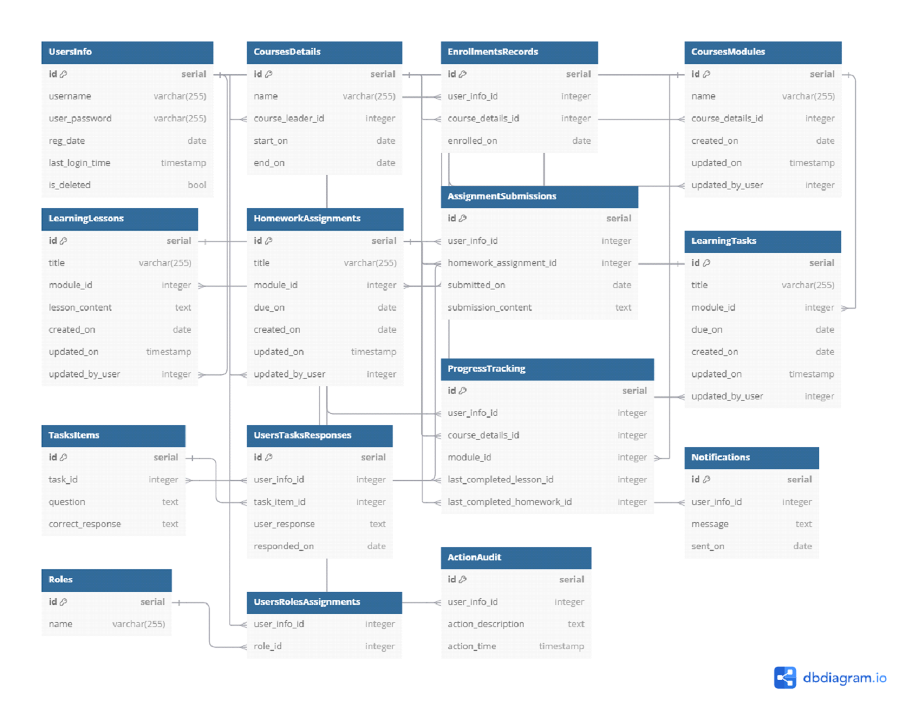

# 🎓 Educational Platform Database Architecture

> A comprehensive relational database schema designed for an e-learning system. Developed as a university lab project to demonstrate data normalization, complex relational mapping, and server-side business logic using PostgreSQL.

## 🗄️ Entity-Relationship Diagram
Below is the visual representation of the database schema showcasing the relationships between all 15 core entities:

## 🛠️ Tech Stack
* **Database Engine:** PostgreSQL
* **Programming:** SQL, PL/pgSQL
* **Design Tool:** dbdiagram.io

## ⚙️ Core Architecture
The database consists of 15 fully normalized tables handling the complete lifecycle of an educational platform:
* **Users & Access:** `UsersInfo`, `Roles`, `UsersRolesAssignments`.
* **Course Management:** `CoursesDetails`, `CoursesModules`, `LearningLessons`, `EnrollmentsRecords`.
* **Testing & Assignments:** `HomeworkAssignments`, `LearningTasks`, `TasksItems`.
* **Tracking & Logs:** `AssignmentSubmissions`, `UsersTasksResponses`, `ProgressTracking`, `ActionAudit`, `Notifications`.

## 🚀 Business Logic (PL/pgSQL Functions)
To ensure data integrity and reduce backend processing, core business rules are implemented directly at the database level:
* `check_module_access()`: Validates user permissions for specific modules based on assigned roles and previous progress.
* `get_overdue_tasks_for_user()`: Identifies past-due assignments by comparing submission records against current timestamps.
* `change_user_role()`: Safely reassigns user privileges while maintaining referential integrity.
* `delete_user_and_related_data()`: Handles cascading deletion and soft-deletes (`is_deleted` flag) for user records.